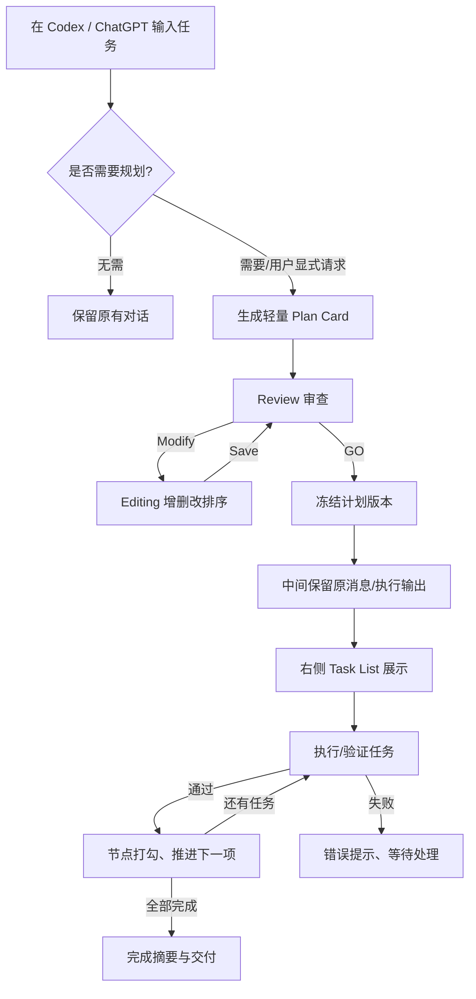

# TaskWeave V2.0 产品需求文档（PRD）

> **产品代号**：TaskWeave（临时命名，正式发布前需核验）  
> **文档版本**：V2.0 / Rev 1  
> **日期**：2026-10-15  
> **文档状态**：产品需求基线，尚未进入开发验收  
> **目标平台**：V1 首发 VS Code + Codex；V1.1/P1 扩展 ChatGPT 网页插件；后续支持 Gemini、DeepSeek 等规划模型  
> **配套文档**：[TaskWeave V2.0 技术方案](./TaskWeave_V2.0_Technical_Design.md)

## 1. 产品概述

### 1.1 一句话定义

**TaskWeave 是一个附着在现有 AI 对话界面中的轻量化任务规划与执行进度插件。** 用户描述复杂任务后，AI 生成可以修改的任务计划；用户审核后点击 **GO**；计划以右侧 Task List 的形式持续显示，原聊天区域继续呈现模型公开的回答、推理摘要和工具活动，任务经确认完成后自动打勾。

### 1.2 产品理念

> **Plan before execution, track during execution.**  
> 执行前先规划，执行中持续追踪。

产品不是另一个聊天机器人、网页 IDE 或大型流程引擎。用户仍在 VS Code 的 Codex CLI、Codex 管理会话或 ChatGPT 网页中完成主要交互，TaskWeave 只提供必要的工作流“辅助层”。

### 1.3 本版与旧方案的区别

| 维度 | 早期方案 | V2.0 正式定位 |
|---|---|---|
| 核心界面 | 独立大型工作流页面 | 对话内紧凑 Plan Card + 右侧 Task List |
| 任务结构 | 可视化 DAG 流程图 | 默认线性任务列表，可排序、插入、删除 |
| 主交互 | 拖拽节点与自由连线 | Modify / Save / GO 简单操作 |
| 执行后 | 在画布上标记节点状态 | 原对话不变，右侧自动勾选任务 |
| 首发平台 | 偏独立 VS Code 工作流 UI | 优先融入 VS Code 的 Codex 使用习惯 |
| 网页端 | 另做独立网页 | 尽量基于 ChatGPT 插件 UI / Conversation Panel |
| 未来扩展 | 多 Agent | 分离规划模型与执行 Agent，支持多模型 |

### 1.4 要解决的用户问题

1. 对复杂需求，用户无法在 AI 动手前清晰审查其执行范围、顺序和遗漏项。
2. 当前 AI 的多轮工具输出较长，用户很难快速知道整体任务执行到哪里。
3. AI 口头报告“完成”与真正通过测试之间存在差距，缺少明确的任务级结果。
4. 用户不愿为了查看进度而离开熟悉的聊天/编码环境。
5. 如果未来更换模型，用户希望保留同一套任务规划体验。

---

## 2. 用户与核心场景

### 2.1 目标用户

| 用户群 | 典型场景 | 核心诉求 |
|---|---|---|
| 个人开发者 | 在 Codex 中实现功能、修复 Bug、重构项目 | 明确步骤、不漏环节、完成情况可见 |
| AI 编程重度用户 | 经常给 Codex 提出跨文件开发任务 | 减少黑盒感，追踪运行 |
| 科研与工程用户 | 编写仿真分析脚本、测试程序、实验报告 | 可审查计划、保留验收证据 |
| ChatGPT 网页用户 | 通过对话制定和推进多步骤任务 | 任务可编辑、可跟踪、无需单独项目平台 |

### 2.2 非目标用户 / 场景

首版不面向需要多人分派、复杂审批、工时统计和甘特图的企业项目管理场景；也不要求每次问答都创建任务计划。简单释义、翻译、普通问答，应直接保持原有对话体验。

### 2.3 典型用户故事

**故事 A：VS Code / Codex 开发任务**

用户在 VS Code 中提出：“帮我写一个 Python 脚本，读取 ADC 输出 CSV 数据，完成 FFT、SNDR、SFDR 和 ENOB 计算，并增加自动化测试。”

系统识别为多步骤任务，生成 Plan Card：

1. 分析 CSV 数据与采样率约定。
2. 设计 FFT 计算接口。
3. 实现窗函数与频谱算法。
4. 计算 SNDR / SFDR / ENOB。
5. 编写数值一致性测试。
6. 生成使用说明。

用户点击 Modify，在“FFT 计算接口”和“频谱算法”之间插入“检查相干采样及窗函数选择”，删除“不必要的绘图导出”，保存后点击 GO。左侧或中间保留 Codex 原本输出，右侧显示 1/6、2/6 等进度；某项测试未通过时，不显示绿色完成勾。

**故事 B：ChatGPT 任务辅助**

用户在 ChatGPT 中要求整理一份研究学习计划。TaskWeave 工具被显式调用后生成可编辑任务卡片；用户检查并 GO，右侧出现任务列表。若任务仍由 ChatGPT 原生对话推进，TaskWeave 应明确显示“模型报告/待确认”的进度来源，而不是伪称有严格的自动执行控制。

**故事 C：简单问题无需打扰**

用户在 Codex 中问：“解释这个函数为什么需要锁。”默认 Ask 模式不强制弹出计划流程；用户继续获得普通回答。

---

## 3. 产品目标、成功定义与版本范围

### 3.1 核心产品目标

| ID | 目标 | 结果 |
|---|---|---|
| G-01 | 减少复杂 AI 任务的计划不透明 | 用户能在执行前看懂任务步骤 |
| G-02 | 让用户可低成本修改计划 | 插入、删除、改名、排序无需输入长 Prompt |
| G-03 | 不牺牲原有聊天工作流 | 聊天仍是主要区域，Task List 可收起 |
| G-04 | 提高进度感知 | 用户能识别已完成、进行中、待执行、失败 |
| G-05 | 保证“完成”含义可信 | 受控任务经验收后才显示绿色勾选 |
| G-06 | 为跨模型扩展预留接口 | 产品视觉和核心模型不绑定 Codex |

### 3.2 MVP 范围（必须完成）

- VS Code 插件安装、打开、关闭、配置。
- Codex Managed Mode：生成计划、编辑、保存、GO、逐节点执行、状态反馈。
- Compact Plan Card：Modify、插入、删除、编辑、重排、Save、GO。
- 右侧 Task List：显示状态、进度、完成打勾、失败提示。
- 保留受控 Codex 的公开消息/工具活动与可得的推理摘要。
- 本地任务记录、会话恢复、失败停止和明确的 Retry 操作。
- 原生 CLI Companion Mode 技术验证，以及用户可开启/关闭的辅助能力（自动精确追踪需在验证结果允许时再承诺）。

### 3.3 P1 / P2 范围

| 级别 | 功能 | 说明 |
|---|---|---|
| P1 | ChatGPT MCP Plan Card | 通过插件工具提供结构化计划和编辑 |
| P1 | ChatGPT Conversation Panel | 在支持该能力的客户端显示右侧列表 |
| P1 | ChatGPT Native 状态来源提示 | 区分模型汇报与可验证完成 |
| P1 | 执行历史与局部重试增强 | 适应较长工作流 |
| P2 | Gemini/DeepSeek Planner Adapter | 模型切换与 API Key 配置 |
| P2 | 多 Agent Executor | 非 Codex 执行器 |
| P2 | 执行中 Replan | 变更未来节点，要求新的审批与版本 |
| P2 | 跨设备/跨宿主同步 | 需账户、授权与服务端同步 |
| P2 | DAG/并行任务 | 另行设计图形交互与冲突处理 |

### 3.4 明确不承诺

- 不承诺任意 ChatGPT 普通输入都先进入 TaskWeave 规划。
- 不承诺从 ChatGPT 网页或原生 Codex TUI 获取模型隐藏完整 Thinking。
- 不承诺原生 CLI Companion Mode 必定能够接管同一个 Turn 逐节点执行。
- 不承诺 AI 只凭生成文本就能被判断为“真正完成”。
- 不默认自动执行风险命令，不绕过 Codex 既有安全审批机制。

---

## 4. 用户旅程与信息架构

### 4.1 用户旅程

### 4.2 两类展示区域

**A. Plan Card（规划阶段）**：紧贴当前任务对应的 AI 对话显示，卡片包含标题、任务条目、各项简要描述及 Modify / GO。默认紧凑，不显示庞大流程图。

**B. Task List（执行阶段）**：GO 成功后出现在右侧，显示任务进展；原对话区域用于模型消息、工具活动和反馈；右侧可以收起并重新打开。

> UI 设计规则：所谓“卡片平移到右侧”在工程实现上是两个 UI 视图复用同一数据、触发折叠/展开效果，不要求真正跨宿主 DOM 移动。

---

## 5. 核心功能需求（按优先级）

### F-01 任务入口与智能规划触发（P0）

**目的**：只有任务确有规划价值时才打断用户。

**触发模式**：

- `Off`：完全不自动触发，用户可主动调用 TaskWeave。
- `Ask`（默认）：识别疑似多步骤任务并建议规划，用户选择是否采用。
- `Always`：对符合条件的任务自动生成计划，但排除简单问答、已运行任务的补充消息与重复触发。

**输入**：用户原始需求；可选工作区文件概况、技术栈等上下文；已授权的模型 Provider。

**输出**：一份待审查的任务列表，通常 3–8 步，简单任务不超过 3 步，复杂任务可设上限；不需要生成图形依赖边。

**异常**：规划超时、结构不合法、无模型权限时显示原因与重试/直接聊天入口，不能卡住整个聊天产品。

**验收**：默认 Ask 不会对普通解释性问题强制 GO；用户主动规划时能输出可编辑的稳定任务列表。

### F-02 Plan Card 审查视图（P0）

**默认状态**：Review，只读。

每个任务行显示：序号、任务名称；可选一行简短描述；点击展开显示完整执行指令和验收要求。

卡片底部：左侧 `Modify`，右侧主按钮 `GO`。右上角可以折叠卡片或重新生成建议，但不要同时摆放太多控制项。

**验收**：用户可浏览但不能在未点击 Modify 时直接修改任务；较长标题自动换行或省略并可查看完整内容。

### F-03 Modify 任务编辑（P0）

用户点击 Modify 后进入 Editing，GO 禁用，左侧按钮转换为 `Save`；另提供明确的取消编辑入口。

操作包括：

| 操作 | 交互 | 规则 |
|---|---|---|
| 修改名称 | 点击铅笔/行标题 | 非空，合理长度 |
| 修改指令 | 展开详情后编辑 | 不在只读模式开放 |
| 相邻任务间插入 | 点击两项之间的 `+` | 新建任务并更新顺序 |
| 删除任务 | 点击垃圾桶，必要时二次确认 | 不允许删至 0 项 |
| 调整顺序 | 拖拽手柄或上下移按钮 | 保存前预览新顺序 |
| 保存 | 点击 Save | 结构校验后新建计划版本 |
| 取消 | 点击 Cancel | 放弃草稿，不覆盖已保存版本 |

**验收**：添加任务后顺序更新且 Task ID 不重复；保存失败保留编辑内容；未保存内容不能被 GO 执行。

### F-04 GO 审批与启动（P0）

**前置条件**：处于 Review、存在合法计划、执行器可用、无冲突中的执行实例。

**点击效果**：

1. 禁止重复点击，显示短暂“启动中”状态。
2. 保存用户确认的计划版本与运行 ID。
3. 启动运行成功后，Plan Card 折叠为摘要。
4. 右侧 Task List 展开，自动定位当前任务。
5. 原聊天区域继续显示已有对话和后续模型输出。

**异常**：执行器未连接、权限不足、版本已过期时保持 Review，并显示具体处理建议；不得先切 UI 再假装任务已启动。

**验收**：快速连续点击 GO 只生成一个 Run；Running 状态禁止直接修改该 Run 的已审批任务。

### F-05 右侧 Task List（P0）

**显示信息**：任务序号、标题、状态图标、简短活动说明、整体已完成 `x / N`；当前任务高亮；失败任务显示可展开错误摘要。支持折叠侧栏与恢复。

**状态设计**：

| 状态 | 建议 UI | 含义 |
|---|---|---|
| Pending | 空心圆/灰色 | 等待执行 |
| Running | 蓝色活动图标 | 执行器正在处理 |
| Verifying | 校验图标 | 执行结束、等待验收 |
| Completed | 绿色对勾 | 通过适用的完成判定 |
| Failed | 红色警示 | 执行或验收失败 |
| Cancelled | 灰色删除线/提示 | 用户取消 |
| Unknown | 问号/黄色提醒 | 中断后无法确认真实状态 |

**验收**：侧栏不遮挡全部对话；窗口重启后状态恢复；历史任务可点开查看简要结果。

### F-06 模型输出与活动（P0）

TaskWeave 不取代中间的模型输出：

- Codex CLI Companion：终端原样显示用户习惯的输出。
- Codex Managed：在 TaskWeave 的轻量活动输出区显示 Agent 消息、支持的推理**摘要**、命令活动与公开日志。
- ChatGPT Plugin：ChatGPT 原生聊天内容保持原样；插件只渲染自己的卡片和右侧面板。

**验收**：用户知道当前输出对应哪一个 Task；不能对外承诺显示模型未开放的完整隐藏推理。

### F-07 自动任务完成反馈（P0）

**产品原则**：绿色勾选应有可追溯的来源。

- Managed 模式：执行单元成功结束，且所有必要验收通过，才显示 Completed。
- Companion 或 ChatGPT Native：若只获得模型自行上报，则展示“模型报告已完成”或“待确认”，不得冒充严格验收。
- 用户手动确认应明确记录为 `manual`，与自动测试通过区分。

动画：完成时绿色打勾约 250–400ms，可提供简短通知；尊重系统减少动态效果设置。

整体进度：已确认完成任务数除以总任务数。当前单任务不强行显示伪精确百分比。

### F-08 错误、Retry、取消与恢复（P0）

- 执行错误：明确任务、失败原因、建议下一步。
- Retry：由用户发起，创建新尝试并保留历史；不能不对账就重复修改文件。
- Cancel：请求取消当前 Run；显示“取消请求中”直到得到真实确认。
- Reload：侧栏重新打开后先读取快照；Unknown 不自动标绿也不自动重跑。
- Pause：首版可只在任务边界停止继续派发，必须在文案中写清楚。

### F-09 Codex Companion Mode（P0 技术验证，首版可限功能）

用户在 VS Code 终端继续输入 `codex`。TaskWeave 允许用户开启 CLI Hooks 观察输入和部分生命周期事件，提供建议规划与 Task List。

**能力边界**：不能保证任意原生会话可以被完全暂停、自动原位恢复或逐步派发；此模式下的完成状态须有来源提示。若验证未满足要求，首发只保留显式规划入口，自动执行推荐 Managed Mode。

**验收**：启用/禁用清楚；禁用后不影响用户原生 Codex；Hook 出错有可诊断提示而非静默丢失。

### F-10 Codex Managed Mode（P0，可靠执行主入口）

TaskWeave 管理 Codex app-server Turn；按线性任务顺序创建执行尝试，获取事件、运行验收并驱动 Task List。用户可以选择该模式以实现完整 GO 闭环。

**验收**：三个实际开发步骤可顺序执行；第二步失败时第三步不启动；Task 只有验证完成才打勾。

### F-11 ChatGPT 网页端（P1）

优先以 MCP Plugin 工具提供计划生成/修改/审批；如果目标客户端支持，在对话内展示 Inline Plan Card，并通过 Conversation Panel 显示右侧 Task List。

**需要明确区分**：

- `ChatGPT Native`：由原生 ChatGPT 继续处理，TaskWeave 仅能获取主动提供的信息，执行进度不保证精确。
- `TaskWeave Managed`：将任务交给受控 Executor，提供可靠的 TaskAttempt 状态和验收。

不能假定插件能无条件拦截全部用户输入，也不能从网页 DOM 获取隐藏推理。若目标客户端不支持侧面板，需要有可理解的降级界面；Chrome Side Panel 可列为备选项目，而非默认必做。

### F-12 多模型规划（P2）

允许用户在设置中选择 Codex、Gemini、DeepSeek 等 Planner（以实际账户/API 可用性为准），结果均转化为同一 Plan 格式。执行器可以继续是 Codex；纯模型 API 不自动具备读写代码和执行命令的能力。

---

## 6. 详细交互规范

### 6.1 Review → Editing

- 入口：点击 `Modify`。
- 响应：每行露出编辑、删除操作；行间出现 `+`；显示拖拽手柄；GO 置灰。
- 退出：Save 校验通过或 Cancel 丢弃草稿。
- 异常：保存失败时不退出 Editing；保留用户编辑内容和错误定位。

### 6.2 Editing → Review

- 生成新 Revision，与旧 Revision 一并保留。
- 保持用户当前滚动与选中任务，避免卡片跳动。
- Restore/Undo 属于体验增强，首发至少支持取消整个编辑会话；多步 Undo/Redo 可 P1。

### 6.3 Review → Running

- 点击 GO 后等待服务端/本地 Run 创建确认。
- 成功后 Plan Card 变成一行“执行中 · 查看任务”，右侧 Task List 展开。
- 中间保留原对话/终端或受控活动流，用户继续知道 Codex 在做什么。
- 如果右侧空间不足，允许折叠成窄栏或显示悬浮入口，不能遮挡输入框。

### 6.4 Running → Completed / Failed

- 单节点通过验收：变绿并播放一次短动画；无需弹出强打断式模态框。
- 全部完成：显示完成摘要、任务数、交付物入口，允许展开查看。
- 失败：任务红色高亮，解释失败环节，提供“查看日志”“重试”“取消”。
- 自动通知默认轻量；同一次完成事件只触发一次动画和提醒。

### 6.5 页面刷新、切换会话

- 同一 Run 恢复到最后确认的状态。
- 若没有可靠执行状态，则展示 Unknown / 等待同步，不冒称正在运行或已完成。
- 多个历史 Run 的切换应清楚展示项目、生成时间及运行标识；首版可以只支持当前 Run + 历史列表。

---

## 7. 页面与组件清单

| 页面/组件 | VS Code | ChatGPT P1 | 用途 |
|---|---|---|---|
| Entry / Mode Selector | 是 | 插件工具入口 | 发起规划、选择行为模式 |
| Compact Plan Card | TaskWeave View / 受控会话 | Inline Widget | 审查步骤 |
| Task Editor | Plan Card 内 | Plan Card 内 | 增删改排 |
| GO Control | 是 | 是 | 审批运行 |
| Right Task List | Secondary Sidebar | Conversation Panel | 追踪任务 |
| Activity / Log | Codex CLI 原生或受控输出 | ChatGPT 原生对话 | 输出和活动 |
| Task Detail | 展开或轻量弹层 | 展开或弹层 | 指令、验收与交付 |
| Error / Retry | 是 | 按执行模式 | 错误处理 |
| Settings | VS Code 设置页 | Plugin 设置（视支持情况） | Planner、触发策略、权限 |

### 7.1 视觉设计原则

- 不出现大型画布、网格背景、复杂工具栏；一屏优先看任务和执行内容。
- 尽量使用宿主既有字号、主题色、间距风格；VS Code 支持浅/深色主题。
- 主 CTA 仅有一个：Review 状态显示 GO，Editing 状态显示 Save。
- 行内新增入口只在 Editing 显示，避免长期视觉噪声。
- 右侧宽度建议 280–360px，可由用户调整或收起。
- 常用状态含文本与图标，不能仅靠颜色辨认；可键盘操作，支持屏幕阅读器。

### 7.2 文案原则

- “任务已完成”仅用于通过规定完成判定的情况。
- 对仅由模型描述的进展写“模型报告已完成”或“待确认”。
- 对缺少事件写“状态暂不可确认”，而不是“失败”或“完成”。
- “GO”表明同意启动计划，不代表同意执行所有高风险命令。
- 侧栏关闭仅隐藏视图，不等于取消任务。

---

## 8. 状态、规则与数据需求

### 8.1 任务状态表

| 状态 | 可见名称 | 迁移条件 |
|---|---|---|
| Pending | 待执行 | 计划启动后尚未派发 |
| Running | 执行中 | 真实执行尝试已开始 |
| Verifying | 验收中 | 执行成功后开始校验 |
| Completed | 已完成 | 验收通过或有明确的人工确认 |
| Failed | 失败 | 执行/验收失败 |
| Cancelled | 已取消 | 取消已被确认 |
| Unknown | 状态待确认 | 进程中断且无法可靠对账 |

产品上不必向用户展示全部技术字段，但后台至少需要 `planId`、`revisionId`、`taskId`、`runId`、`attemptId`、Provider 执行引用与事件来源，以避免状态串台。

### 8.2 默认规则

1. 任务数量：默认生成 3–8 项，可配置上限；过长计划应拆分阶段而非一次列几十行。
2. 任务顺序：首版串行执行，列表顺序即默认执行顺序。
3. 保存规则：Modify 的更改不自动执行；Save 后新建 Revision。
4. 完成规则：受控执行不允许仅凭文本“已完成”打绿勾。
5. 失败规则：默认停止派发后续任务，由用户决定 Retry/Cancel。
6. 取消规则：请求取消不等于立即完成取消；需等待执行器确认。
7. 调整规则：运行中不能直接改写已审批 PlanRevision；P2 才支持 Replan。

---

## 9. 非功能需求

### 9.1 轻量与性能

- 插件应无独立大型网页服务依赖，VS Code 首版尽量本地运行。
- 常见 5–10 项任务列表应流畅；最多按 50 项可滚动展示进行性能测试。
- GO、Save 等关键操作提供加载反馈；不承诺未经实测的固定耗时。
- 长日志需截断/虚拟化，不能让 Task List 因工具输出过大而卡顿。

### 9.2 安全与隐私

- 启用 Hooks 需要用户明确知情和可关闭入口。
- 插件默认不上传全部聊天历史、不读取与任务无关的文件。
- API Key 等凭据使用安全存储，不写入可分享的计划文件。
- 用户可以查看会发送给外部 Planner/Executor 的任务内容范围。
- 执行风险操作继续遵循 Codex/宿主审批策略；GO 不是万能授权。
- 应允许清除本地历史与日志。

### 9.3 可用性与无障碍

- 支持 VS Code 暗色与亮色主题。
- 文字、图标、状态颜色应适应高对比度需求。
- 所有按钮可通过键盘聚焦，新增/删除操作具备清晰语义。
- `prefers-reduced-motion` 下减少动画。
- 网络或模型中断时保持草稿可恢复。

### 9.4 兼容与发布

VS Code 首版应声明并测试明确的最低版本及支持操作系统；ChatGPT Plugin 端应逐客户端验证可用性，不能把文档里存在的 Conversation Panel 等同于“所有用户已可使用”。

---

## 10. 边界情况与错误体验

| 情况 | 用户看到什么 | 产品处理 |
|---|---|---|
| 模型输出了非法计划 | 规划失败，支持重试/直接聊天 | 校验并限制重试 |
| 计划含重复任务 | 建议合并或用户手动修改 | 不自动删掉可能有用的任务 |
| 用户删除全部任务 | 显示至少保留一项 | 禁止 Save/GO |
| 编辑期间点击 GO | GO 禁用 | 不能提交未审批草稿 |
| 连续快速点击 GO | 一次启动反馈 | 后端幂等去重 |
| Codex 中途请求权限 | 明确审批 UI | 不因 GO 自动放行 |
| Codex 回答“已完成”，测试失败 | 显示 Failed | 不自动打勾 |
| 用户关闭 Task List | 对话继续、可再次展开 | 不取消 Run |
| 宿主重启或断开 | 显示恢复中/Unknown | 拉取快照并对账 |
| ChatGPT 原生会话无任务事件 | 显示报告型/待确认状态 | 不虚报严格进度 |
| Companion Hook 失效 | 显示接入异常及关闭/修复提示 | 原 CLI 尽量保持可用 |
| API 超时或配额不足 | 明确原因和重试入口 | 不静默死循环 |

---

## 11. 成功指标与数据埋点（拟定）

### 11.1 北极星指标

**已审批且被可信跟踪至终态的复杂任务 Run 数量**（按活跃用户/周统计）。它同时要求用户真正使用规划和进度反馈，而不是只看生成次数。

### 11.2 关键指标与目标方向

| 指标 | 定义 | 目标性质 |
|---|---|---|
| Plan Adoption Rate | 建议规划后进入 Review 的比率 | 上线后建立基线 |
| Plan Edit Rate | 审查计划中至少发生一次编辑的比例 | 验证编辑价值 |
| GO Conversion | Review 后成功启动 Run 的比率 | 验证完成闭环 |
| Verified Completion Rate | 受控 Run 中通过全部验收的比例 | 不应通过放宽验收人为提高 |
| Task Status Accuracy | UI 完成状态与验收记录的一致性 | 发布门槛为零已知假完成 |
| Plan Interruption Rate | 用户因不需要规划而退出的比例 | 越低越好 |
| Recovery Success | 断线后可正确对账/标明 Unknown 的比例 | 作为可靠性测试指标 |
| Sidebar Reopen Rate | 关闭后再次打开进度栏的比例 | 判断右侧面板价值 |

### 11.3 建议埋点（默认最小化）

- `plan_suggested`、`plan_created`、`plan_edited`、`plan_saved`
- `run_start_requested`、`run_started`、`task_started`、`task_completed_verified`
- `task_failed`、`run_cancelled`、`run_recovered`、`run_unknown`
- `sidebar_opened`、`sidebar_closed`

默认仅记录事件类型、匿名运行标识和必要耗时，不采集完整 Prompt 或模型输出；实际遥测采集与外发需向用户明确告知，并允许控制。

---

## 12. 发布验收清单（产品视角）

| ID | 测试步骤 | 期望结果 |
|---|---|---|
| P-AC01 | 用户输入复杂开发任务 | 能获得结构合理、可阅读的 Plan Card |
| P-AC02 | 未点击 Modify 就尝试编辑 | 无法改动任务 |
| P-AC03 | Modify 后插入中间任务 | 新任务出现在正确位置，序号更新 |
| P-AC04 | 删除、改名、排序后 Save | 审查视图反映新版本内容 |
| P-AC05 | Editing 中尝试 GO | GO 被禁用，不能启动 |
| P-AC06 | 保存后点击 GO | 卡片折叠，右侧列表展开，中间输出不消失 |
| P-AC07 | Managed 模式完成第一项并验收 | 第一项变绿并打勾，下一项进入 Running |
| P-AC08 | 第二项测试失败 | 第二项显示失败，第三项不执行 |
| P-AC09 | 关闭并重新打开 Task List | 状态、任务顺序正确恢复 |
| P-AC10 | Codex 意外中断 | 显示失败或 Unknown，不自动标绿 |
| P-AC11 | 原生 Codex CLI 关闭 TaskWeave Hooks | 继续正常使用 CLI |
| P-AC12 | ChatGPT Plugin 运行在不支持面板的客户端 | 有清晰降级而非空白或死按钮 |
| P-AC13 | 未获得可靠任务事件的 ChatGPT 原生会话 | 不显示虚假的“已验证完成” |
| P-AC14 | 减少动态效果设置开启 | 动画减少且功能正常 |
| P-AC15 | 用户查看执行权限提示 | GO 与具体工具审批语义明确区分 |

**发布阻断条件**：任何已知的未经验证自动打绿勾、GO 重复执行、Hook 导致原 CLI 不可用且无法关闭、越权执行风险操作等问题，均应阻断正式发布。

---

## 13. 研发里程碑与产品交付

| 里程碑 | 产品交付 | 依赖 |
|---|---|---|
| M0：接入研究 | Codex Hook 和 app-server 能力验证报告 | 官方接口实测 |
| M1：交互原型 | Plan Card + Modify + Save + GO 完整模拟流程 | UI 基础组件 |
| M2：Codex 受控执行 | 三步实际执行，右侧列表真实打勾，失败可见 | Managed Adapter 与 Run Controller |
| M3：VS Code 测试版 | VSIX、模式开关、恢复、基础验收、文档 | 集成/安全测试 |
| M4：ChatGPT PoC | 插件工具、计划卡片与 Conversation Panel 验证 | 客户端和账户可用性 |
| M5：网页端 P1 | 正式可用或有明确降级方案 | M4 通过后展开 |
| M6：多模型规划 | Gemini、DeepSeek 的 Planner Adapter | API 及密钥管理 |

粗略工程量参考配套技术方案：VS Code 首版约 20–31 人日，网页端增量约 10–19 人日，均为未实测估计，不含额外缓冲。

---

## 14. 风险、依赖与待决策项

### 14.1 产品风险

| 风险 | 影响 | 产品策略 |
|---|---|---|
| 强制规划打断简单聊天 | 降低使用意愿 | Ask 默认、可关闭、简单问题跳过 |
| Companion 无法精确追踪 | 用户误解完成状态 | 区分报告型/验证型状态 |
| ChatGPT 原生能力受限 | 网页端原型无法完全实现 | 优先官方插件 PoC，再确定 P1 交付口径 |
| 用户编辑过多步骤 | UI 仍可能臃肿 | 紧凑列表、详情折叠、数量建议上限 |
| 执行失败后重新运行混乱 | 信任下降 | 清晰 Run/Attempt 历史、Retry 语义 |
| 插件与原生 Codex Plan 重叠 | 差异化不足 | 强调统一可编辑任务 UI 与跨模型状态管理 |

### 14.2 需要产品负责人确认的问题

1. **V1 首发默认入口**：`Ask` 模式下优先在 VS Code 侧栏展示建议，还是用户通过命令面板主动触发？当前建议两者并存，以显式入口为最可靠路径。
2. **GO 默认执行模式**：建议以 Managed Mode 保障自动勾选；Companion 的 GO 应另有清晰描述。
3. **首发验收策略**：对没有自动化测试的任务，建议使用明确的人工确认或产物检查，不直接自动标绿。
4. **ChatGPT 发布策略**：先验证官方插件是否可支持 Conversation Panel，不预设所有客户端可用。
5. **品牌名称**：TaskWeave 当前仅为项目代号，正式发布前进行商标、域名、软件市场与仓库名称核验。

---

## 15. 最终发布建议

**建议首个公开测试版本仅承诺以下完整能力：**

> 在 VS Code 中，用户通过 TaskWeave 生成和修改计划，点击 GO 后由 TaskWeave 管理 Codex 执行；原模型输出保留在对话/活动区域，右侧 Task List 根据真实执行与验收结果逐项打勾。

CLI Companion 能保留 `codex` 原生使用方式，但其自动规划拦截和节点级追踪应按实测能力逐步开放。ChatGPT 网页端先通过官方 MCP Plugin UI 完成体验验证，在兼容范围明确后上线，避免将平台不可控行为包装成确定性功能。

**PRD 最终原则**：用户体验必须比原生聊天增加更少的操作成本，却提供更清楚的执行计划、更可靠的完成状态和更便捷的任务修改能力。

---

## 附录：主要产品与平台参考

1. [Codex Hooks](https://developers.openai.com/codex/hooks/)
2. [Codex app-server](https://developers.openai.com/codex/app-server/)
3. [OpenAI Plugin Extensions](https://developers.openai.com/plugins/build/extensions)
4. [OpenAI Plugin UI Guidelines](https://developers.openai.com/plugins/guides/ui-guidelines)
5. [VS Code Views](https://code.visualstudio.com/api/ux-guidelines/views)
6. [Chrome Side Panel](https://developer.chrome.com/docs/extensions/reference/api/sidePanel)
