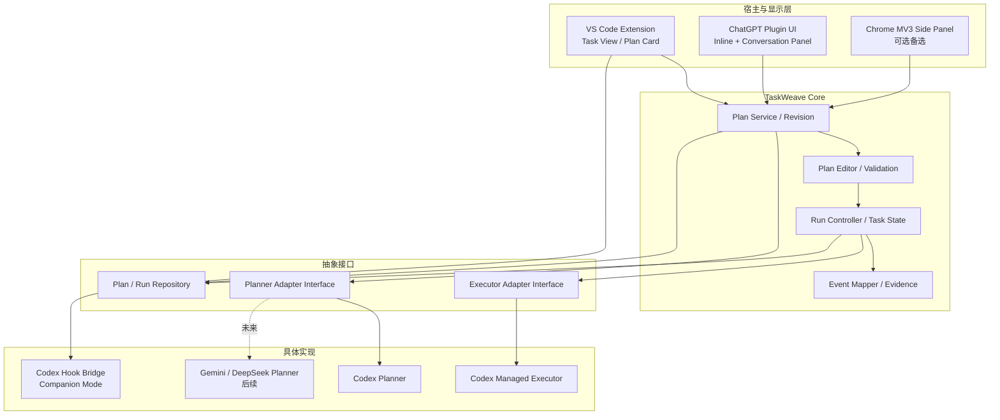
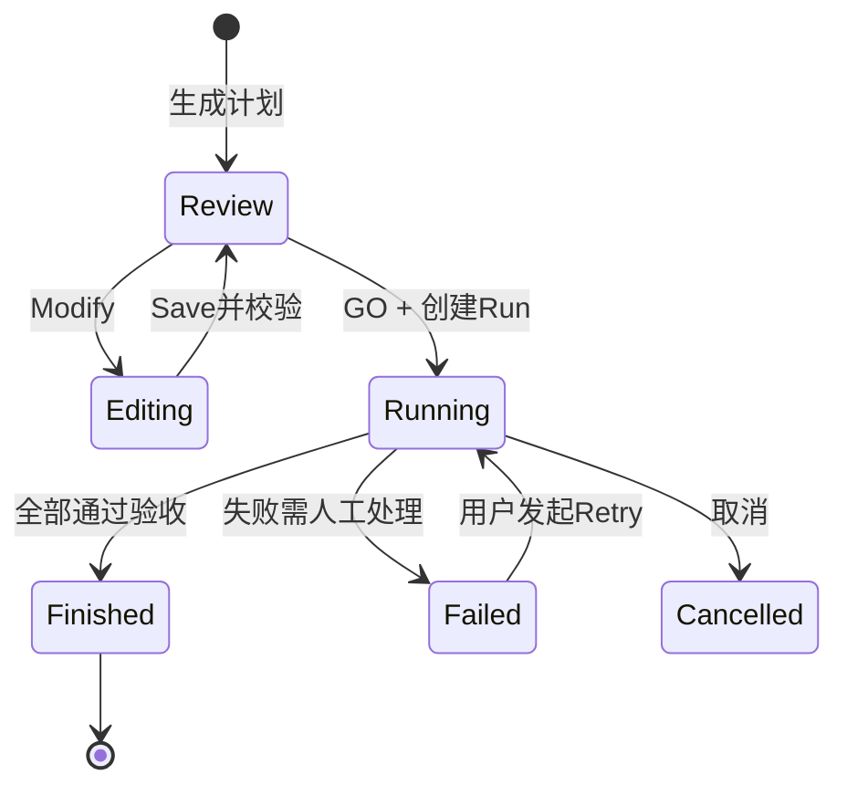
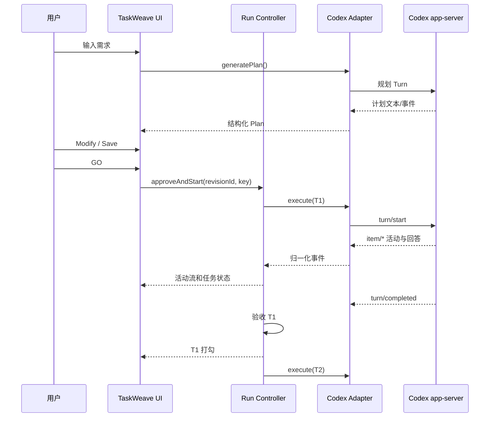

# TaskWeave V2.0 技术设计说明书（TDD）

> **文档状态**：工程设计基线（非已实现系统）  
> **版本**：V2.0 / Rev 1  
> **日期**：2026-10-15  
> **首发平台**：VS Code + Codex CLI / Codex Managed Execution  
> **后续平台**：ChatGPT Plugin UI、可选浏览器扩展；规划模型拓展至 Gemini、DeepSeek 等  
> **临时项目代号**：TaskWeave（正式产品名需商标与命名核验）

## 0. 执行摘要

TaskWeave 是附着于现有 AI 对话环境中的轻量任务规划与执行追踪插件。它**不重建聊天产品**，而是在用户下达较复杂任务时提供可编辑的计划卡片；点击 **GO** 后，计划以右侧 Task List 形式持续展示，中间区域继续承载 Codex/ChatGPT 原有的消息、公开推理摘要和工具活动；已验证的任务完成后自动打勾。

V2.0 对 V1.0 的主要取舍：

1. 取消 React Flow、ELK.js、自由拖拽 DAG 画布，首发改为**线性可排序任务列表**。
2. 保留轻量 Run Controller、不可变计划版本、Adapter 接口和执行验收——界面可轻，状态判定不能粗糙。
3. VS Code 采取 **Companion Mode（原生 `codex` + Hooks）** 与 **Managed Mode（app-server 受控执行）** 双模式。
4. ChatGPT 以 **MCP Plugin + 对话内 UI + Conversation Panel** 作为优先验证路线；Chrome MV3 Side Panel 作为备选，不采用未公开的会话接口。
5. 清楚区分 **Planner（规划）**、**Executor（执行）** 与 **Host（VS Code / ChatGPT）** 的职责和权限。

**最重要的工程结论**：想实现可验证的“每做完一步自动打勾”，需要 TaskWeave 控制的执行尝试和验收证据。仅观察原生聊天文字或 Hooks，不能保证获得同等精度。

---

## 1. 约束、目标与非目标

### 1.1 设计目标

| ID | 技术目标 | 判定方式 |
|---|---|---|
| T-01 | 用户保留熟悉的 Codex/ChatGPT 对话体验 | 不要求进入独立工作流网站 |
| T-02 | 在原有交互附近展示轻量 Plan Card | 可以插入、删除、修改、排序、保存 |
| T-03 | GO 后显示右侧 Task List | 可见任务状态并与聊天并存 |
| T-04 | 可证明的节点完成同步 | Managed Mode 将 TaskAttempt 关联到 Codex Turn 与验收记录 |
| T-05 | 原生 CLI 尽量不受干扰 | Hooks 可关闭、失败时清晰降级 |
| T-06 | 多模型扩展 | 新 Planner/Executor 可独立注册，无需重写核心 UI |
| T-07 | 运行安全与可恢复 | 有版本冻结、幂等、取消、失败、Unknown 状态与恢复路径 |

### 1.2 非目标（V2.0 首发不做）

- 全功能可视化 DAG、条件分支及并行调度。
- 独立网页聊天客户端和云端多租户平台。
- 复杂的项目管理（Sprint、团队审批、工时计费）。
- 在 ChatGPT 官方网页中任意修改原生布局或读取未公开内部数据。
- 获取模型隐藏完整思维链（仅展示平台公开的推理摘要/活动）。
- 对任何普通 ChatGPT 对话保证自动、真实、逐节点执行。
- 对原生 Codex CLI 任意会话保证与 Managed Mode 相同的执行控制。

### 1.3 术语

- **Plan**：尚未执行的任务列表。
- **PlanRevision**：经过保存的不可变计划快照。
- **Run**：对某个已审批计划版本的一次执行。
- **TaskDefinition**：任务的标题、执行指令、验收要求等静态定义。
- **TaskRun**：某 Run 中一条任务的状态。
- **TaskAttempt**：任务的一次实际执行或重试。
- **Planner Adapter**：将需求转为统一 Plan 的模型连接模块。
- **Executor Adapter**：派发任务并回传执行事件的 Agent 连接模块。
- **Companion Mode**：原生 CLI + Hooks 的辅助式接入。
- **Managed Mode**：TaskWeave 控制 Codex Turn 的受控执行模式。
- **Evidence**：工具结果、测试报告、文件产物或明确人工确认等验收证据。

---

## 2. 平台能力与边界（截至 2026-10-15）

### 2.1 VS Code / Codex

**Codex Hooks**：官方文档列有 `UserPromptSubmit`、`PreToolUse`、`PostToolUse`、`Stop` 等事件；`UserPromptSubmit` 包含 `prompt`、`turn_id`，可使用文档定义的 `decision: "block"` 等返回形态。该能力适合观察/拦截输入，但不等于“无限期暂停某个 Turn 等待用户点击 GO”，因为 Hooks 有生命周期、超时与错误语义。`transcript_path` 不是稳定接口。详见 [Codex Hooks](https://developers.openai.com/codex/hooks/)。

**Codex app-server**：提供会话/Turn 的请求与事件，支持更可控的执行管理。`turn/plan/updated` 是 Agent 自身计划状态，不应与 TaskWeave 的已审批计划混同；`item/*` 事件更适合作为具体活动来源。详见 [Codex app-server](https://developers.openai.com/codex/app-server/)。

**VS Code Extension API**：普通扩展可创建自己的 View/Webview，但不能假定能够向第三方 Codex 扩展的私有聊天 DOM 注入 React 控件。首版的 Plan Card 位于 TaskWeave 自有视图/受控会话 UI，原生 CLI 保留终端显示；需要“原生终端内部可点击卡片”的方案属于额外 TUI 工程，不纳入首发。

### 2.2 ChatGPT

ChatGPT 插件文档列有 MCP 工具、插件 UI 和 **Conversation Panels**（在对话旁打开插件 UI）等扩展方向，适合作为右侧任务列表的宿主能力；**具体客户端、账户和审核要求需要在开发环境验证**。参见 [Plugin Extensions](https://developers.openai.com/plugins/build/extensions)、[Plugin UI Guidelines](https://developers.openai.com/plugins/guides/ui-guidelines)。

插件只能可靠控制自己的工具、状态与 UI，不能默认拦截任意普通 ChatGPT 输入、强制控制所有模型内部动作、读取隐藏推理或内部工具事件。若需要网页端精确自动打勾，应采用 TaskWeave Managed Executor，而不是仅根据模型回答猜测进度。

### 2.3 兼容性矩阵

| 能力 | Codex Managed | Codex Companion | ChatGPT Plugin Native | ChatGPT + Managed Executor |
|---|---|---|---|---|
| 计划生成与编辑 | 是 | 是，位于 TaskWeave UI | 是，受宿主 UI 能力约束 | 是 |
| GO 启动 | 是 | 能提供审批入口；原生同会话续跑需验证 | 可提交计划，但原生执行受限制 | 是 |
| 原聊天输出保留 | TaskWeave 展示 app-server 公开事件 | Codex CLI 原样显示 | ChatGPT 原样显示 | ChatGPT 交互 + 外部事件摘要 |
| 节点级 Turn 关联 | 是 | 不保证 | 不保证 | 是 |
| 严格自动完成判定 | 是，需验收 | 仅可观测范围内 | 不保证 | 是 |
| 原生隐藏 Thinking | 不支持 | 不支持 | 不支持 | 不支持 |

---

## 3. 逻辑架构



**部署说明**：这是逻辑依赖图，不要求 V1 将所有内容运行在一个云进程。VS Code 使用本地 Core 与本地存储；ChatGPT MCP 侧使用服务端 Core/存储。前期不做跨端数据同步。

### 3.1 包结构与建议仓库

```text
taskweave/
├── packages/
│   ├── core/
│   │   ├── model/                # Plan / Run / Task
│   │   ├── plan-editor/          # 插入/删除/排序、版本与校验
│   │   ├── run-controller/       # 串行调度、取消、验收、恢复
│   │   ├── events/               # 事件类型、归一化与订阅
│   │   └── ports/                # Planner/Executor/Repository 接口
│   ├── ui/
│   │   ├── PlanCard.tsx
│   │   ├── TaskList.tsx
│   │   ├── TaskItem.tsx
│   │   ├── TaskEditor.tsx
│   │   ├── TaskProgress.tsx
│   │   └── styles/
│   └── adapters/
│       ├── codex-planner/
│       ├── codex-executor/
│       └── codex-hook-bridge/
├── apps/
│   ├── vscode/
│   │   ├── extension.ts
│   │   ├── TaskViewProvider.ts
│   │   └── ipc/
│   ├── chatgpt-plugin/           # P1：MCP Server + UI
│   └── browser-extension/       # 仅兼容方案
├── tests/
│   ├── unit/
│   ├── integration/
│   ├── contracts/
│   └── e2e/
├── docs/
└── pnpm-workspace.yaml
```

技术栈：TypeScript、React、CSS Modules、Zod、dnd-kit（可选拖动排序）、Lucide、Vitest；VS Code 用 Extension API + WebviewView；首版存储本地 JSON 快照 + JSONL 事件（必要时直接使用 SQLite）。禁止为了任务列表引入 React Flow 或重型 BPM 引擎。

---

## 4. 用户交互与 UI 状态

### 4.1 标准流程



| 视图状态 | 中间对话区 | 计划卡片 | 右侧任务列表 | 可操作项 |
|---|---|---|---|---|
| Review | 原有消息 | 展开，只读 | 默认隐藏 | Modify、GO、查看详情 |
| Editing | 原有消息 | 可编辑 | 隐藏 | 插入、删除、改名、指令编辑、排序、Save/Cancel |
| Running | 原生/受控输出正常显示 | 折叠成摘要 | 展开，实时刷新 | 查看结果、取消（按能力） |
| Finished | 继续对话 | 完成摘要 | 保留勾选 | 查看交付物、复制计划 |
| Failed | 错误和日志 | 摘要 | 失败节点突出显示 | Retry、查看日志、取消 |

**动画实现**：点击 GO 后折叠 Plan Card 并展示 Side Panel，而非真正跨 Webview DOM 迁移同一个节点。两个视图共享同一 `runId`/Store；动画 250–350ms，支持 `prefers-reduced-motion`。

### 4.2 交互不变量

- 未进入 Editing 模式，不允许更改任何任务定义；后端须复核，不能只靠灰色按钮。
- Editing 时 GO 禁用；Save 必须通过校验。
- GO 绑定审批时的 **PlanRevision**，不能执行浏览器本地未保存的草稿。
- Running 后不直接修改当前 Run 的任务定义；如需重新规划，另建版本与执行实例。
- 执行进度由状态与证据决定；UI 动画本身不驱动业务状态。
- 用户关闭右侧任务栏不应取消后台 Run；宿主/运行时生命周期限制除外。

### 4.3 简化任务编辑

第一版默认线性列表：`T1 → T2 → T3`。在 T2/T3 之间插入时成为 `T1 → T2 → Tx → T3`；删除节点后保留其余项原有相对顺序。内部以 `orderIndex` 管理显示顺序，保存前重新计算顺序并校验 ID 唯一、指令非空、数量范围。

无需 DAG 循环检测（当前不支持任意依赖边），但是务必保留稳定 Task ID，以避免移动任务后历史事件错配。

---

## 5. 数据模型和接口合同

### 5.1 领域模型

```typescript
export type PlanStatus = 'draft' | 'approved';
export type TaskStatus =
  | 'pending' | 'running' | 'verifying' | 'completed'
  | 'failed' | 'cancelled' | 'unknown';

export interface Criterion {
  type: 'command' | 'file_exists' | 'artifact' | 'manual';
  commandId?: string; // 只能引用经许可的命令注册表
  path?: string;
  description?: string;
}

export interface TaskDefinition {
  id: string;                // 稳定 UUID
  orderIndex: number;        // 线性执行顺序
  title: string;
  description?: string;
  instruction: string;
  acceptanceCriteria: Criterion[];
}

export interface PlanRevision {
  id: string;
  planId: string;
  version: number;
  tasks: TaskDefinition[];
  contentHash: string;       // 标准化 JSON 的摘要
  createdAt: string;
}

export interface TaskAttempt {
  id: string;
  runId: string;
  taskId: string;
  attemptNo: number;
  provider: string;
  providerThreadId?: string;
  providerTurnId?: string;
  status: TaskStatus;
}

export interface WorkflowRun {
  id: string;
  revisionId: string;
  status: 'running' | 'paused' | 'completed' | 'failed' | 'cancelled' | 'unknown';
  idempotencyKey: string;
}
```

要点：**静态 TaskDefinition 不保存当次执行状态**；同一个计划可以运行多次。`TaskRun` 保存某次 Run 的节点状态，`TaskAttempt` 保存重试记录与 Provider 引用。

### 5.2 Planner Adapter

```typescript
export interface PlannerAdapter {
  readonly id: string;
  generate(request: {
    requirement: string;
    workspaceSummary?: string;
    maxTasks: number;
  }, signal?: AbortSignal): Promise<TaskDefinition[]>;
}
```

必须校验 Planner 输出的结构化 JSON，不把模型返回文本当作可信代码执行。首次规划失败允许有限次数重试，再向用户展示具体错误。未来加入 Gemini/DeepSeek 时，只扩展 Planner Adapter，不要求它们具有文件执行能力。

### 5.3 Executor Adapter

```typescript
export type ExecutorEvent =
  | { type: 'started'; attemptId: string }
  | { type: 'activity'; attemptId: string; text: string }
  | { type: 'approval_required'; attemptId: string; requestId: string }
  | { type: 'tool_activity'; attemptId: string; tool: string; text: string }
  | { type: 'succeeded'; attemptId: string; result: string }
  | { type: 'failed'; attemptId: string; message: string }
  | { type: 'interrupted'; attemptId: string };

export interface ExecutorAdapter {
  readonly id: string;
  capabilities(): {
    cancel: boolean;
    reconcile: boolean;
    streaming: boolean;
  };
  execute(task: TaskDefinition, ctx: {
    runId: string;
    attemptId: string;
    workspacePath: string;
  }, signal: AbortSignal): AsyncIterable<ExecutorEvent>;
  cancel?(attemptId: string): Promise<void>;
  reconcile?(attemptId: string): Promise<'running' | 'succeeded' | 'failed' | 'unknown'>;
}
```

`ExecutorEvent.succeeded` 意味着 Turn 执行结束，不等同于业务验收通过。允许不同 Adapter 明确声明不支持取消或恢复。状态不明确时返回 `unknown`，禁止盲目重试有副作用的任务。

### 5.4 执行事件、可信度与去重

```typescript
export interface TaskEvent {
  eventId: string;
  sequence: number;
  runId: string;
  taskId: string;
  attemptId: string;
  type: 'started' | 'progress' | 'verification_passed' | 'failed' | 'completed';
  source: 'executor' | 'verification' | 'model_report' | 'manual';
  timestamp: string;
  payload?: Record<string, unknown>;
}
```

- 以 `(runId, eventId)` 去重；同一 Run 的 `sequence` 单调递增。
- 前端发现事件断档时先取 Run 快照再继续订阅。
- 来自 `model_report` 的“已完成”不能在严格验收模式中直接迁移为 Completed。
- `threadId`、`turnId` 和 `attemptId` 的关联是 Managed Mode 自动追踪的关键。

---

## 6. VS Code 集成：双模式详细设计

### 6.1 Companion Mode：保留 `codex` CLI

**场景**：用户仍在 VS Code 终端输入 `codex` 并与其交互。TaskWeave 注册显式授权的 Hooks，以观察 Prompt 与相关生命周期事件；Plan Card 显示在 TaskWeave 自有视图或通过命令唤起，右侧 Sidebar 同步可观测状态。

基本流程：

1. 用户安装 TaskWeave，选择启用 Companion Mode 并同意 Hook 配置。
2. Hook 从 stdin 接收官方定义的结构化内容，并迅速返回或记录事件。
3. 对复杂任务可建议打开 TaskWeave Plan Card；是否 block 提交取决于用户选择的规划策略。
4. 用户保存计划并 GO 后，**不能假定 Hook 能恢复同一个被阻止的 Prompt**。应提供明确的续跑/重新提交路径，且只在被验证支持时自动化。
5. 任务状态来自可观测 Hook、模型报告或人工确认；显示可信度，不强行全部标绿。

**Hook 设计要求**：独立小进程、快速响应、超时保护、最小日志、退出码/JSON 严格符合当前版本文档。示意配置见官方 [Codex Hooks](https://developers.openai.com/codex/hooks/)；不硬编码未经运行验证的用户目录路径。不要依赖不稳定的 transcript 文件格式解析完整对话。

**限制**：无法保证原生 CLI 的任意 Turn 可由 TaskWeave 逐节点调度；需将 Companion 的“辅助规划 + 可观察进度”与 Managed 的“可验证自动执行”在 UI 中分别表述。

### 6.2 Managed Mode：主推荐执行路径

**场景**：用户从 VS Code 的 TaskWeave 命令、快捷键或侧栏发起，TaskWeave 管理 app-server 连接并逐个提交 Task Turn。中间可采用轻量只读活动流，也可并排保留用户原先的终端；不承诺把事件注入已有 Codex 扩展私有界面。



**关键规则**：

- app-server `initialize` 在连接建立时执行，不是在每个任务前重复初始化。
- `turn/completed` 要检查真实完成状态；它不表示业务验收已通过。
- 将 app-server 中可获得的消息、工具活动、推理**摘要**映射到显示事件。
- Codex 原生计划事件 (`turn/plan/updated`) 不直接覆盖用户批准的 TaskWeave Plan。
- 默认单工作区串行执行，防止多个 Turn 同时修改同一代码库。
- 对当前 Provider 版本生成类型或做契约测试，避免硬编码可能变化的字段。

### 6.3 规划与执行权限隔离

- Planner 只读分析；不要授予无必要的写入权限。
- Executor 在当前工作区内操作，遵循 Codex sandbox/审批策略。
- GO 是计划审批，并不授权所有危险命令、外部网络或高权限访问。
- 不允许因 Planner 输出含有指令就直接执行 Shell。

---

## 7. ChatGPT 双路径集成

### 7.1 优先：官方 MCP Plugin UI

- MCP Tools：`create_plan`、`get_plan`、`update_plan`、`approve_plan`、`start_run`、`get_run_status`、`cancel_run`。
- Inline UI：生成计划时展示可编辑卡片。
- Conversation Panel：GO 后显示工作流状态并持续关联 Run。
- Plugin 服务端持久化会话与计划，必要时进行授权身份映射。

**重要边界**：工具注册不保证普通 ChatGPT 消息自动先经 TaskWeave；GO 对 ChatGPT Native 模式的含义是把计划交给当前会话继续，不能保证模型逐项调用状态上报工具。若需硬性节点验收，`start_run` 必须调用由 TaskWeave 控制的外部 Executor。

**状态共享方式**：Inline Plan Card 与 Conversation Panel 共同读取同一 `planId`/`runId`，点击 GO 后前者折叠、后者展开，不依赖跨 UI 容器的元素位移动画。若插件 UI 功能未对用户开放，显示可用性说明并降级到 Inline 结果或其他宿主。

### 7.2 备选：Chrome Extension MV3

组成：Content Script（仅插入必要 UI）+ Service Worker（消息路由）+ Side Panel（任务列表）+ IndexedDB（草稿与缓存）。在已授权页面使用隔离样式，尽量避免影响 ChatGPT 原生 DOM。

禁止将 ChatGPT 未公开的内部会话接口作为核心依赖，也不得将完整聊天内容默认发送第三方服务。MV3 Worker 有生命周期限制，因此所有必要状态必须持久化；浏览器扩展 UI 无法天然获取完整模型执行事件。

### 7.3 跨端同步（非首发）

首发 VS Code 使用本地存储，ChatGPT Plugin 使用服务端存储，二者 schema 统一但数据不共享。未来要从 ChatGPT 看到 VS Code 本地 Run，需要显式授权的数据桥接和认证，不允许假定任意两个端已自动互通。

---

## 8. Run Controller 与完成判定

### 8.1 串行调度

```text
approveAndStart(revision, idempotencyKey)
  -> 事务性记录 Run 和 TaskRuns
  -> 选择下一个 pending 任务
  -> 创建 TaskAttempt
  -> Executor.execute()
  -> 接收并存储事件
  -> Executor 结束后进入 verifying
  -> Acceptance Engine 判定
       ├─ pass: TaskRun=completed → 发送事件 → 下一任务
       └─ fail: TaskRun=failed → 暂停后续派发
```

只有所有必需验收条件均满足时：

`Completed(task) = ExecutionSucceeded(task) AND AcceptancePassed(task)`

可用的验收类型：`command`（命令注册表）、`file_exists`、`artifact`、`manual`。自动测试必须显式允许；不适合自动验收的任务需要人工确认。对于 ChatGPT Native 模式，可以显示 `reported`/`awaiting_confirmation` 等非强验收提示，不能误标为“已验证”。

### 8.2 进度与动画

`progress = completedTaskCount / totalTaskCount * 100%`。

- 当前执行任务使用转圈/活动信息，不显示无法保证的“任务内 73%”。
- `verification_passed` + 完成事件提交后才呈现绿色勾选。
- 轻量 250–400ms 勾选动画，通知可关闭；非活动窗口通知按宿主系统能力处理。

### 8.3 故障恢复

- GO 请求使用 `idempotencyKey`，防止连续点击产生重复 Run。
- 同一工作区采用单运行锁；进程崩溃后须核查是否仍有活动执行器。
- 重新加载时先读快照、再读增量事件。
- Provider 状态未知时置 `unknown`，严禁自动重跑已经可能写过文件的任务。
- `Pause` 首版定义为**任务边界暂停**，不承诺在写文件中途冻结 Codex。
- Retry 创建新的 `TaskAttempt` 并保留历史，先确认原尝试已结束。

---

## 9. 主机通信、存储与安全

### 9.1 VS Code IPC 合同

```typescript
export interface IpcRequest<T = unknown> {
  protocolVersion: 1;
  requestId: string;
  type: 'plan.generate' | 'plan.save' | 'run.start'
      | 'run.get' | 'run.cancel' | 'task.retry';
  payload: T;
  expectedRevisionId?: string;
}

export interface IpcEvent<T = unknown> {
  protocolVersion: 1;
  runId: string;
  sequence: number;
  type: string;
  payload: T;
}
```

Host 校验所有 IPC 消息、工作区路径、计划版本和用户权限。UI 状态不是安全边界。

### 9.2 存储建议

**VS Code 首版**：`PlanRevision` JSON 快照 + 追加式 JSONL 事件 + Run 索引；写入使用临时文件/原子替换、文件锁或单写者模式。需要更强事务一致性时，直接使用 SQLite，不应坚持 JSON 到影响安全的程度。

**ChatGPT MCP**：服务端持久化 Plan/Run/用户关联；本地 PoC 可用 SQLite，正式上线按部署模型选取数据库与身份验证方案。

**敏感信息**：API Key 放 SecretStorage/安全密钥管理，不记录在计划 JSON 或用户可导出的日志里；执行日志做令牌、绝对路径及个人信息的最小化处理。

### 9.3 安全边界

1. Prompt Injection：仓库内容、工具输出和网页消息为不可信输入，不能覆盖权限策略。
2. 执行权限：GO 不等于允许任意工具调用；高风险操作仍由 Provider 的授权流程处理。
3. 路径校验：工作区外文件访问要求额外权限；校验规范化路径及符号链接。
4. Webview：严格 CSP，限制资源来源，不使用不受控的 HTML 注入。
5. Hook：需要用户显式启用；快速返回；失败与超时可诊断且可关闭。
6. 隐私：ChatGPT 网页接入不得默认抓取完整历史聊天。
7. 日志：可禁用、可导出/清除，避免包含密钥。

---

## 10. 测试计划、验收与性能目标

### 10.1 分层测试

| 层级 | 典型场景 |
|---|---|
| Unit | 插入/删除/重排、稳定 Task ID、版本哈希、非法状态转移、进度计算 |
| Contract | Codex 事件映射、取消支持、异常码、重复事件、能力声明 |
| Integration | 真实 app-server 三步运行、失败停机、验收关联、权限请求 |
| VS Code E2E | Review → Modify → Save → GO → 侧栏完成；主题、窗口重载 |
| ChatGPT PoC | 插件工具可调用、Inline UI、Conversation Panel 可用性、刷新恢复 |
| Resilience | 重复 GO、断线、崩溃、未知状态、重试副作用 |

### 10.2 首发验收标准

| ID | 验收条件 |
|---|---|
| AC-01 | 5–10 项任务生成并通过结构校验；失败时给出可理解原因 |
| AC-02 | Review 状态不可编辑；Modify 下可以插入、删除、改名、重排并保存 |
| AC-03 | GO 绑定不可变 PlanRevision，连续点击只产生一个 Run |
| AC-04 | Managed 模式下每个 TaskAttempt 有可追踪的 Codex Turn 或等价标识 |
| AC-05 | 模型口头表示“完成”而验收失败时，不出现绿色完成勾 |
| AC-06 | 任务 B 失败后不会启动任务 C |
| AC-07 | UI 关闭再打开可以恢复快照；状态未知时不自动重试 |
| AC-08 | Companion Mode 关闭后原生 `codex` 正常运行，不残留拦截逻辑 |
| AC-09 | ChatGPT 端必须说明受宿主扩展能力与可用性限制；不虚报原生执行状态 |
| AC-10 | 界面保留原有聊天为主要区域，计划卡片与任务列表可收起 |

**建议性能目标（未实测）**：10 项任务列表常规交互流畅；50 项以内可滚动；本地 UI 切换主观响应不明显；动画 250–400ms，尊重减少动态效果设置。不得把这些目标写为已达成数据。

---

## 11. 开发阶段、工程量与依赖

| 阶段 | 交付物 | 估算 |
|---|---|---:|
| P0 | 验证 Codex Hooks 的输入/拦截/异常与 app-server 事件 | 3–5 人日 |
| P1 | 轻量 Plan Card、Modify、Save、GO 的 UI | 4–6 人日 |
| P2 | Codex Managed Adapter + Planner JSON 解析 | 5–8 人日 |
| P3 | Run Controller、验收、事件、恢复、自动打勾 | 4–6 人日 |
| P4 | VS Code 右侧视图、设置、真实集成测试 | 4–6 人日 |
| P5 | ChatGPT MCP Plugin / Conversation Panel PoC | 5–9 人日 |
| P6 | 网页端正式可用/受限降级与测试 | 5–10 人日 |

**VS Code 首发**：约 20–31 人日；**网页端增量**：约 10–19 人日；合计粗估 30–50 人日，未含兼容性缓冲、发布审核等待。该估计是工程计划，不是交付承诺。

### 11.1 里程碑与 Go/No-Go 门槛

- **M0 接口验证**：验证 Codex CLI Hooks 的真实能力，以及受控 app-server 的 Turn/事件关联。失败则取消“原生命令行完全自动同步”的首发承诺。
- **M1 编辑闭环**：需求 → 计划 → Modify → Save；保存的任务 ID 与顺序稳定。
- **M2 执行闭环**：三项真实代码任务串行执行、验收和自动打勾；中间任务失败停止后续。
- **M3 VS Code 测试版**：右侧 Task List、异常恢复、权限审批与 VSIX 打包。
- **M4 ChatGPT PoC**：验证工具调用、对话内 Plan Card 与 Conversation Panel；未支持时启用降级路径。

---

## 12. 风险清单与应对

| 风险 | 严重度 | 应对 |
|---|---|---|
| 原生 CLI Hook 不足以控制全部 Turn | 高 | Companion/Managed 显式分模式；主闭环依赖 Managed |
| ChatGPT 不能拦截所有普通对话 | 高 | 显式插件入口；不承诺通用拦截 |
| ChatGPT 插件面板可用性差异 | 高 | 功能检测、Inline 降级、必要时 Chrome Side Panel |
| Codex 事件格式更新 | 中高 | Adapter 隔离、生成协议类型、合同测试、兼容版本表 |
| 模型执行越过后续任务 | 中高 | 独立 Turn、范围提示、文件差异检查及验收 |
| 重试造成重复副作用 | 高 | Attempt 标识、先对账再重试、Unknown 不自动重试 |
| UI 状态与真实任务不一致 | 高 | 后端状态为准、事件序号/去重、断档拉快照 |
| 用户被过多计划打断 | 中 | Off / Ask（默认）/ Always；复杂任务触发策略 |
| 隐私和 API Key 泄漏 | 高 | 最小数据、权限确认、安全密钥存储、日志脱敏 |

---

## 13. 未决设计问题

1. 首发是将 Companion 作为默认模式，还是把 Managed 作为更突出的一键 GO 入口？建议默认 Ask + Managed GO，并提供 Companion 兼容。
2. ChatGPT Plugin 的 Conversation Panel 在目标用户账户、桌面/网页客户端中是否可用？必须先用最小插件 PoC 验证。
3. ChatGPT 端 GO 后的执行策略：原生 ChatGPT 辅助模式还是外部 Codex Managed Executor？建议明确两者的状态可信度差异。
4. 数据是否需要跨设备、跨宿主同步？V2.0 明确不实现。
5. 是否允许执行中修改未开始任务？V2.0 首版不允许，后续采用生成新 Revision + Replan 策略。

---

## 14. 官方资料与校验说明

以下为设计时核查的官方入口；具体协议字段、可用性和 Hook 行为应在开发前针对目标安装版本再次验证。

1. [Codex Hooks](https://developers.openai.com/codex/hooks/)
2. [Codex app-server](https://developers.openai.com/codex/app-server/)
3. [OpenAI Plugin Extensions](https://developers.openai.com/plugins/build/extensions)
4. [OpenAI Plugin UI Guidelines](https://developers.openai.com/plugins/guides/ui-guidelines)
5. [VS Code Webview](https://code.visualstudio.com/api/extension-guides/webview)
6. [VS Code Views UX Guidelines](https://code.visualstudio.com/api/ux-guidelines/views)
7. [Chrome Side Panel API](https://developer.chrome.com/docs/extensions/reference/api/sidePanel)
8. [Chrome Content Scripts](https://developer.chrome.com/docs/extensions/develop/concepts/content-scripts)

> **实施结论**：以“共享领域核心 + 轻量 Plan Card/Task List + Codex Managed Executor”为可靠闭环，CLI Hooks 做兼容，ChatGPT Plugin UI 做第二阶段验证。保持界面轻量，并通过执行尝试、证据与版本控制维持状态正确性。
